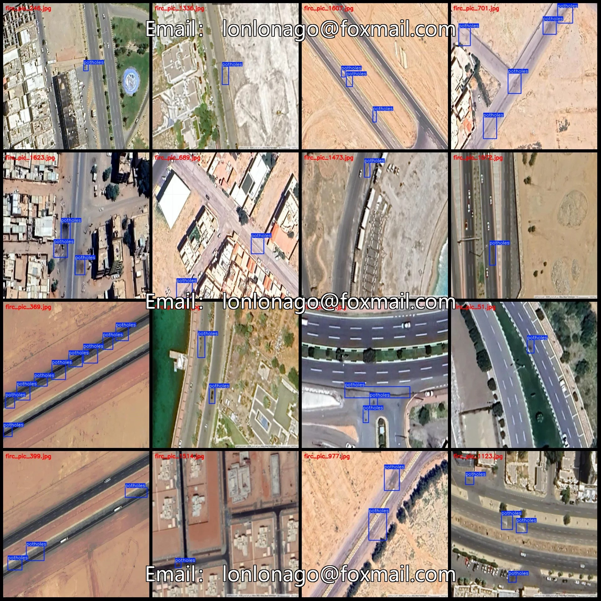
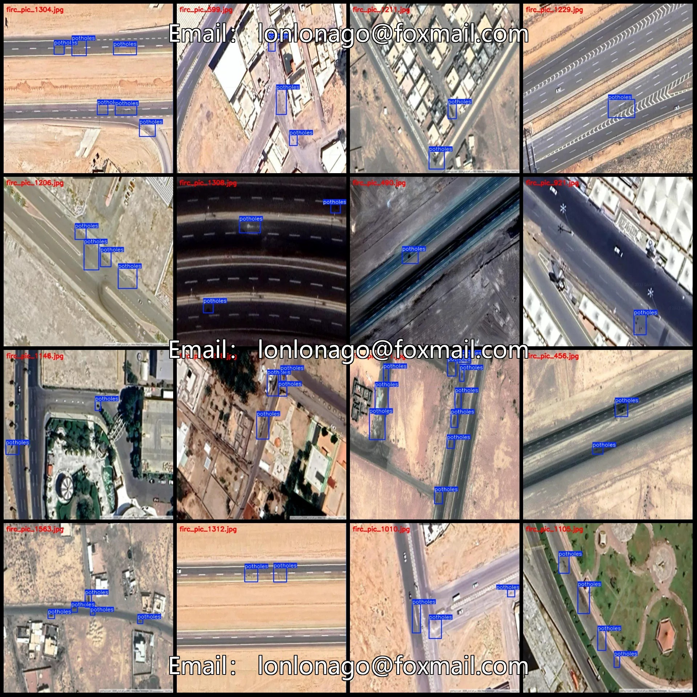
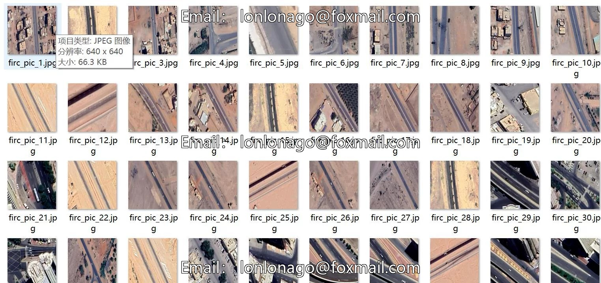
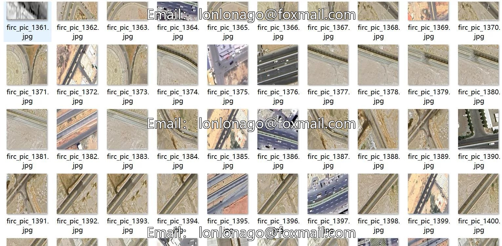
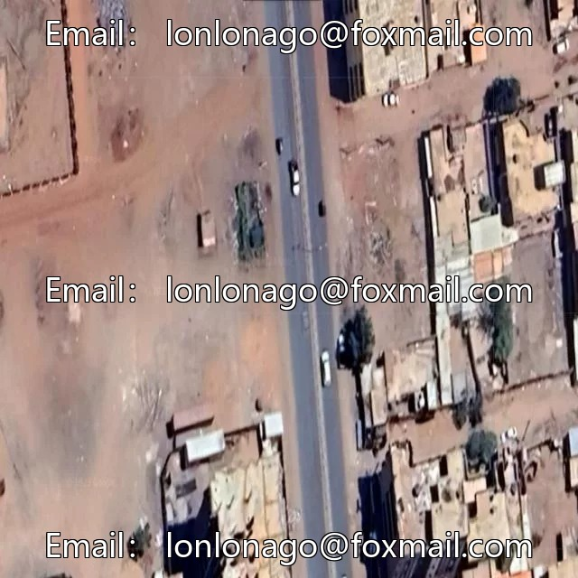
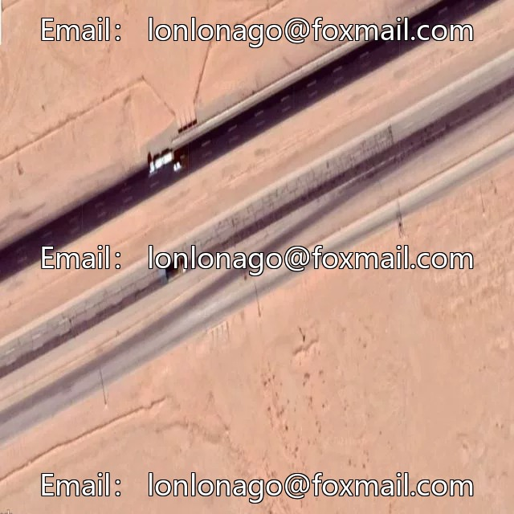
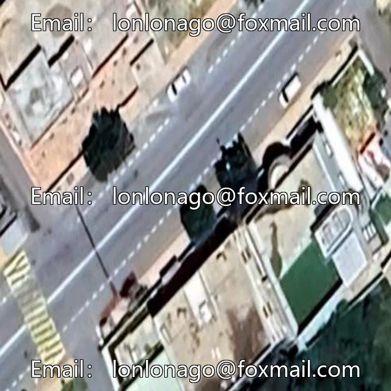

# UAV-Viewpoint Remote Sensing Image Urban Road Holes and Cracks Detection Dataset VOC+YOLO

## Body

Drone-Viewpoint Remote Sensing Image Urban Road Holes and Cracks Detection Dataset VOC+YOLO Format: 1641 Images in 1 Category
Warm Reminder: Due to the dataset's replicability, please confirm compliance with requirements before purchasing.
Please note that the images in the dataset may be unclear; clarity reference is provided for each individual image.
Dataset format: Pascal VOC format + YOLO format (txt file without segmentation paths, only containing jpg images along with corresponding VOC format xml files and yolo format txt files)
Number of images (number of jpg files): 1641
Number of annotations (number of xml files): 1641
Number of annotations (number of txt files): 1641
Number of annotation categories: 1

Annotation Category Name: ["potholes"]
Number of boxes per category:
Potholes boxes = 5041
Total number of boxes: 5041
Number of images per category:
Potholes images = 1641
Image resolution: 640x640
Labeling tool used: labelImg
Annotation rules: Draw a rectangle around the category.
Important Note: The dataset does not have separate training, validation, and test sets; you need to partition them yourself.
Special Remark: This dataset does not guarantee the accuracy of the trained models or weight files.

## Images

## Payment

Here is a pay link on Stripe ( https://buy.stripe.com/3cs8yP7sY87d0vu9AB ). Please contact me lonlonago@foxmail.com after funding $89, and I will send you a complete data files , thank you!

